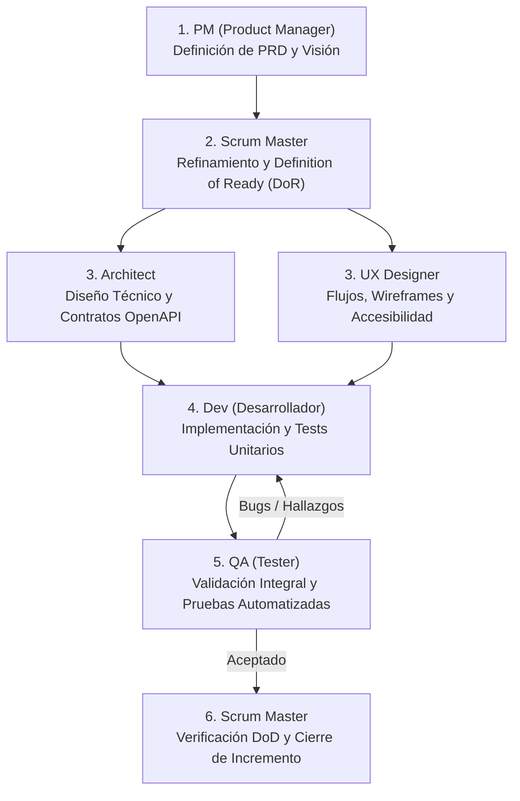

# Guía y Ecosistema de Agentes de Desarrollo (AnimeTracker)

Este directorio define el equipo multidisciplinario de agentes especializados para el desarrollo, diseño, arquitectura, calidad y gestión ágil del proyecto **AnimeTracker**.

---

## 👥 Equipo de Agentes Disponibles

| Agente | Rol | Enfoque Principal | Tecnologías y Herramientas Clave |
| :--- | :--- | :--- | :--- |
| **`architect`** | Software Architect | DDD, Clean Architecture, Monolito Modular, ADRs, contratos API First | .NET 8/10, NestJS BFF, OpenAPI, PostgreSQL, Redis, NetArchTest |
| **`pm`** | Product Manager | Visión de producto, PRDs, priorización de backlog, roadmaps, métricas de éxito | RICE, MoSCoW, OKRs/KPIs, User Personas, Scope Definition |
| **`ux`** | UX/UI Designer | Flujos de usuario, wireframes, accesibilidad WCAG 2.2 AA, microcopy | Heurísticas de Nielsen, tokens de diseño, Angular UI, estados UI |
| **`scrum-master`** | Scrum Master | Facilitación ágil, remoción de impedimentos, DoR, DoD, métricas de flujo | Scrum, Kanban, INVEST, Burndown, WIP Limits, Retrospectivas |
| **`dev`** | Senior Developer | Implementación de código, DDD, TDD, refactorización, resolución de bugs | C# (.NET 8/10), MediatR, EF Core, NestJS, TypeScript, Angular, xUnit |
| **`qa`** | Senior QA Engineer | Pirámide de testing, validación de criterios de aceptación, reporte de bugs | xUnit, Shouldly, Vitest, Playwright, Testcontainers, RestAssured |

---

## 🔄 Flujo de Colaboración entre Agentes

---

## 📋 Reglas de Entrega y Calidad

### Definition of Ready (DoR)
1. Historia en formato de usuario con valor claro.
2. Criterios de aceptación verificables (Given-When-Then).
3. Contratos OpenAPI definidos en `contracts/` si involucra backend/BFF.
4. Estados de interfaz documentados por UX si involucra frontend/extensión.
5. Estimación acordada y dependencias resueltas.

### Definition of Done (DoD)
1. Código limpio siguiendo SOLID y Clean Architecture (`TreatWarningsAsErrors=true`).
2. Cobertura de pruebas >= 80% (unitarias con xUnit / Vitest).
3. Criterios de aceptación verificados y sin bugs críticos abiertos.
4. Pipeline CI (`ci-ok`) en verde en rama `dev`.
5. Documentación de arquitectura y contratos actualizada.
